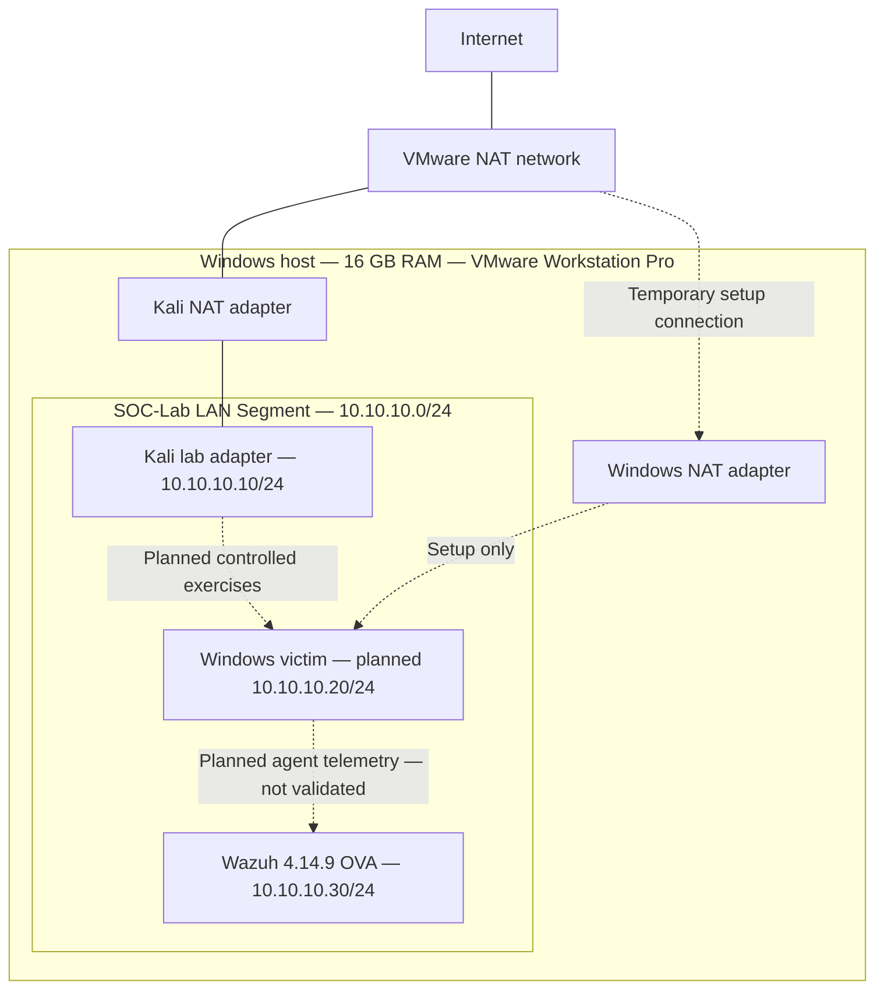

# myhomelab
Exploiting and Examining the OWASP Top ten and their vulnerabilties
# Home SOC Investigations

A developing home lab portfolio for practicing Windows security monitoring, evidence collection, investigation, and response using Wazuh and controlled activity from Kali Linux.

**Current stage:** network setup and dashboard access. Agent installation, enrollment, and Active status have not been confirmed. No attack simulations, custom detection rules, or completed investigations are claimed.

Status statements below are based on the lab owner's supplied observations, not an independent inspection of the VMs. Supporting evidence has not yet been added to this repository.

## Scope

Exercises are limited to personally owned lab systems on `SOC-Lab`. Kali has an additional NAT adapter for internet access, so this is a **segmented lab with an internet-connected Kali machine**, not a fully air-gapped environment. Windows uses NAT temporarily for setup and downloads and returns to SOC-Lab for exercises.

The intended workflow is: define a test and expected telemetry, run controlled activity, preserve evidence, investigate what was actually recorded, document a response, and clean up. Missing telemetry and unsuccessful tests will be documented alongside successful observations.

## Architecture



Lab adapters have no default gateway or DNS server. Kali's separate NAT adapter supplies its internet connection. The diagram does not imply that Kali routes traffic between adapters. Forwarding and the effective isolation boundary still need validation.

| Component | Address or connection | State |
| --- | --- | --- |
| Kali | SOC-Lab: `10.10.10.10/24`; additional NAT adapter | Address and internet access configured, per owner |
| Windows victim | SOC-Lab: planned `10.10.10.20/24`; temporary NAT during setup | Final lab address and exercise adapter state awaiting validation |
| Wazuh | SOC-Lab: `10.10.10.30/24`, interface `eth0` | Persistent static configuration and dashboard access reported successful |

## Progress and evidence status

| Work item | Status | Evidence or next validation |
| --- | --- | --- |
| Create VMware SOC-Lab network | Completed, owner-reported | Capture adapter assignments |
| Configure Kali lab address and internet access | Completed, owner-reported | Capture addresses and routes |
| Investigate setup DNS problems | Observed; resolution incomplete | Preserve sanitized diagnostic output |
| Windows reaches external HTTPS IP and resolves via `1.1.1.1`; default resolver times out | Observed, owner-reported | Final DNS change and successful retest not confirmed |
| Boot Wazuh; configure persistent static address | Completed, owner-reported | Capture configuration and post-reboot address |
| Correct network configuration file location | Completed, owner-reported | Correct file: `/etc/systemd/network/10-soc-lab.network` |
| Access Wazuh dashboard | Completed, owner-reported | Capture sanitized dashboard screenshot |
| Install Wazuh Windows agent 4.14.9 | Instructions provided only | Verify installation and actual version |
| Enroll `Windows-Victim` with manager `10.10.10.30` | Awaiting validation | Verify enrollment, service, and manager connection |
| Agent Active status and incoming Windows events | Awaiting validation | Capture status and a recent attributable event |
| Sysmon and enhanced PowerShell logging | Awaiting validation | Verify installation/configuration and event collection separately |
| Attack simulations and investigations | Planned | No results yet |
| Custom detection rules | Planned | No rules or tests yet |

## Repository layout

```text
home-soc-investigations/
├── README.md
├── .gitignore
├── docs/
│   ├── setup-and-validation.md
│   ├── troubleshooting.md
│   ├── investigation-roadmap.md
│   └── evidence-guide.md
├── templates/
│   ├── incident-report.md
│   └── detection-documentation.md
├── investigations/             # One folder per investigation; currently empty
├── detections/                 # Documented, tested rules or queries; currently empty
├── configs/                    # Sanitized excerpts of actual configuration; currently empty
└── evidence/                   # Reviewed publication copies only; currently empty
```

Empty folders are retained by `.gitkeep` files. Their presence does not indicate completed work.

## Starting points

- [Setup record and validation checklist](docs/setup-and-validation.md)
- [Troubleshooting observations](docs/troubleshooting.md)
- [Three proposed investigations](docs/investigation-roadmap.md)
- [Evidence and publication guide](docs/evidence-guide.md)
- [Incident report template](templates/incident-report.md)
- [Detection documentation template](templates/detection-documentation.md)

## Resource limitations

All three VMs share a Windows host with 16 GB RAM. Actual VM CPU, RAM, disk allocations, host load, and dropped-event behavior have not been recorded. This lab does not demonstrate enterprise scale or performance.

Record allocations before testing; keep sufficient resources for the host and run one exercise at a time. Wazuh and Windows must remain available during collection. Suspend Kali when it is not needed. Record resource pressure, clock discrepancies, and collection gaps because they can affect conclusions. Capture actual settings before publishing a reproducible resource profile.

## Next milestone

Confirm Windows is on SOC-Lab at the planned address, install or verify agent 4.14.9, verify enrollment and Active status, and find a fresh Windows event in Wazuh. Active status alone does not prove the required event channels are being collected. Only then proceed to the first investigation.

## Publication standards

Publish only reviewed evidence with credentials, tokens, personal information, and unrelated system details removed. Keep private originals outside this repository. Distinguish observed events, generated alerts, analyst interpretations, and expected behavior. Do not describe a query match as a custom detection or claim response success without a retest.
